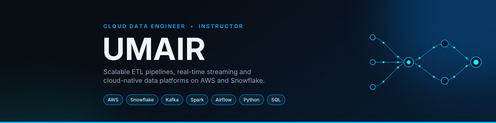

### Cloud Data Engineer | Instructor | Event Organizer

Building scalable ETL pipelines, real-time streaming systems and cloud-native data platforms with **AWS, Snowflake, Kafka and Airflow**. I teach Cloud Data Engineering, mentor the next wave of data engineers, and organize events that bring students and industry leaders together.

---

## 📊 By the Numbers

| 🎓 **60+** | ⚡ **80%** | 🚀 **50%** | 🏆 **2nd Place** | 📜 **20+** |
|:---:|:---:|:---:|:---:|:---:|
| learners mentored | faster ETL pipeline | faster Spark jobs | out of 1,000+ in a data engineering hackathon | certifications |

## 🔭 What I'm Up To

- ☁️ Building cloud data pipelines on AWS and Snowflake, from batch ETL to real-time streaming with Kafka
- 👨‍🏫 Teaching Cloud Data Engineering as a Lead Instructor, designing the curriculum and guiding learners through hands-on projects
- 🎤 Organizing events for students, including a Founder Talk session with an industry leader and hackathons where learners build real data solutions
- 🧠 Always learning, always shipping

## 🛠️ Tech Stack

**Cloud & Data Engineering**

**Languages & Tools**

**Web**

Also working with: Pandas, NumPy, Polars, Snowpipe, AWS Glue, Athena, Redshift, Lambda, SNS and SQS.

## 💼 Experience Highlights

- **Lead Instructor, Cloud Data Engineering**: designed the curriculum, mentored 60+ learners (many from non-IT backgrounds) and organized hackathons
- **Data Engineer**: cut a large ETL pipeline's runtime by 80%, built real-time Kafka streaming with sub-second latency, tuned Spark jobs for 50% faster processing and automated workflows with Airflow
- **Cloud Data Engineer**: built Spark and Airflow ETL pipelines, designed Snowflake data models for real-time dashboards and delivered AWS cloud-native ingestion solutions

## 🚀 Featured Projects

- **Data Warehousing & ETL Pipeline for an Online Learning Platform**: Snowflake, S3, Spark, Airflow, Snowpipe and Power BI
- **Pandemic Insights**: ETL pipeline with AWS Glue, Athena and Redshift
- **Event-Driven Data Processing System**: AWS SNS, SQS, Lambda and S3
- **Real-Time Stock Market Data Pipeline**: Kafka and AWS
- **Real-Time Data Pipeline with SCD**: Apache NiFi, S3 and Snowflake

## 📜 Certifications

- AWS Certified Data Engineer, Associate
- Snowflake: Data Engineering, Data Lake and Data Warehousing
- DataCamp: Data Engineering in Python and Associate Data Engineer in SQL
- 20+ certifications in total across AWS, Snowflake, DataCamp and Udemy

---

⭐ If you like my work, let's connect and build something extraordinary.

